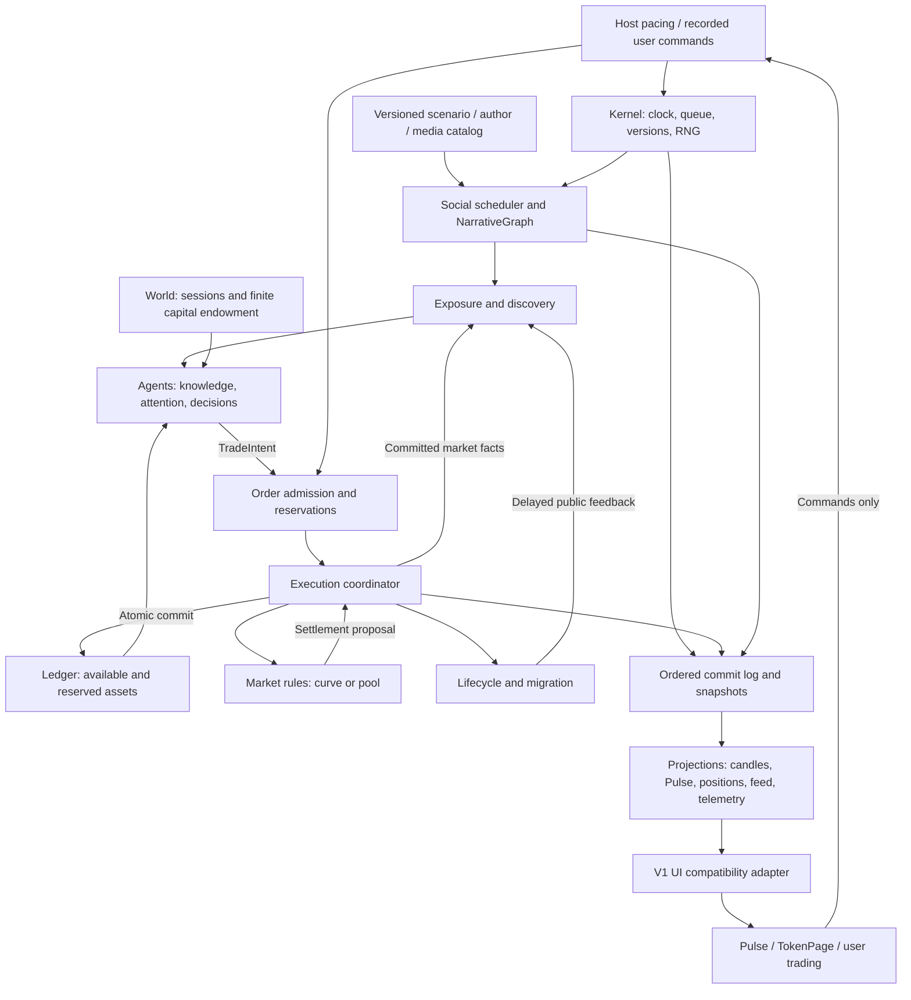

# MEMEX-SIM — Engine V2 Architecture RFC

Status: **FINAL RFC — kontrakty rozstrzygnięte, do zatwierdzenia decyzji końcowych; bez zgody na implementację**. Rewizja: 2, 2026-11-06. Główny kierunek architektury zaakceptowany przez użytkownika. Ta rewizja zamyka execution, compatibility i validation; nie otwiera ponownego audytu architektury.

Rekomendacja: jeden deterministyczny świat, w którym uczestnik posiada kapitał, inventory i ograniczoną wiedzę **przed** podjęciem decyzji. Intencja przechodzi przez rezerwację, kolejkę i atomowe rozliczenie rynku. Social zmienia wiedzę i motywację uczestników; nie zapisuje ceny, rezerw ani sald. Cena jest wynikiem wykonanych transakcji i jawnych operacji płynnościowych.

To projekt STANDARD. Nie jest implementacją, kalibracją ani potwierdzeniem wyższej jakości V2. P2 diagnozuje V1; nie dowodzi, że proponowany model poprawi rozkłady Real. RFC nie zmienia frozen contracts ani nie autoryzuje PR, merge, deploy, dostępu do blockchaina lub rzeczywistych portfeli.

## 1. Podstawa, status twierdzeń i granice

Oznaczenia obowiązują w całym dokumencie:

- **[R]** wymaganie z dokumentu Social lub zadania użytkownika; potwierdzone jako wymaganie, nie jako empiryczny fakt rynkowy.
- **[O]** obserwacja kodu lub wynik istniejącego raportu. Wyniki raportów odczytano, nie wykonano ponownie pomiarów.
- **[D]** proponowana decyzja projektowa do review. Wszystkie kontrakty i algorytmy V2 poniżej mają ten status.
- **[H]** hipoteza albo parametr bez dostatecznych danych; nie wolno prezentować go jako skalibrowanego.

### Źródła

| ID | Źródło | Zakres i ograniczenia |
| --- | --- | --- |
| S1 | [Social Narrative & Crowd Reaction](social-narrative-engine.md), szczególnie §2, 7–16, 19–21 | Wymagania, jakościowe przypadki i jawnie nieskalibrowane propozycje |
| S2 | [AGENTS.md](../../AGENTS.md), [workflow](../ai-workflow.md), [architektura V1](../architecture.md) | Guardrails i historyczny opis; kod rozstrzyga fakty implementacyjne |
| S3 | [SIM-01 baseline](../calibration/sim01/README.md) | 600 świeżych tokenów, SIM01-A/B/C, 200/token, 1800 s, krok 200 ms, 08Z/19Z; bez świata współdzielonego |
| S4 | [Real vs Sim](../calibration/sim01/real-market/report.md), [metodyka](../calibration/sim01/real-market/README.md), [manifest](../calibration/sim01/real-market/sources.json) | Jeden dzień 2026-10-15; Real 20 319 aktywnych standardowych nieinstant ścieżek; A/B po 6000 startów |
| S5 | [P1b](../../output/sim01-p1b/SIM-01-P1b-Activity-Concentration-Flow-Decomposition.md) | Koncentracja, obrót i mianowniki; lokalny ignorowany artefakt, A=`4b976ad` |
| S6 | [P1c](../calibration/sim01/participation-capacity/report.md) | Eksperyment token-local participation reserve, **REJECT**; A=`4b976ad`, B=`f429c99` |
| S7 | [P2a](../../output/sim01-flow-attribution/report.md) | Atrybucja 42 first80 entrants; lokalny artefakt |
| S8 | [P2b](../../output/sim01-p2b/report.md) | 469 first80 entrants, A=`4b976ad`; lokalny artefakt |
| S9 | [P2c](../../output/sim01-p2c/report.md) | Wykonalność alternatywnego holdera na tych samych stanach; lokalny artefakt |
| S10 | [P2d](../../output/sim01-sell-wallet-pilot/report.md) | Pilot 60 par, **INCONCLUSIVE**; lokalny artefakt |

Lokalne linki S5, S7–S10 nie będą dostępne w czystym klonie bez `output/`. Poniżej utrwalono istotne wyniki i ograniczenia, ale nie zastępuje to archiwizacji źródłowych raportów przed przyszłą publikacją RFC. P2e nie wykonano i nie jest warunkiem projektu.

Inspekcja dotyczy checkoutu `1ba362c`, zawierającego eksperymentalny P1c. Nie utożsamiamy go z historycznym A ani z aktualnym zdalnym main. Zastano zmianę `src/store/walletStore.ts` i niewersjonowane dokumenty; pozostają nietknięte.

### Co wynika z pomiarów

| [O] Wynik | Konsekwencja [D], nie obietnica poprawy |
| --- | --- |
| S4: native 80–90%: Real 2.1108 vs A 0.0388 trades/exposed second-bin; puste sekundy 44.62% vs 97.02% | Mierzyć aktywność warunkową i ciszę; nie poprawiać knotów rendererem |
| S5: top 5% aktywnych tokenów ma 54.1642% quote Real vs 17.9826% A; mediana/p99 liczby transakcji 12/1694.64 vs 59/320.46 | Modelować koncentrację uwagi i utrzymywanie aktywnego ogona; nie podnosić globalnie lambda |
| S5: mediana gross/net do first80 3.20 vs 1.52; entrant p99 quote/trade 3.1755 vs 11.5732 SOL | Rozdzielić częstotliwość, rozmiar, recycling i signed net; nie kompensować małej liczby decyzji wielkim orderem |
| S5: wcześniejszy eksperyment PR74 zwiększył count o 91.3%, turnover o 85.1%, migrants 111→460 | Silniejsza pamięć aktywności bez kontroli wielkości i kapitału może rozregulować całą kohortę; to inny eksperyment niż późniejszy P1c |
| S6: P1c top5 +0.272 pp, p99 −1.476%, aktywność 120–600 s +9.654%; wszystkie główne progi FAIL | Nie przenosić participation reserve jako sprawdzonego rozwiązania |
| S7: po alokacji +170.70 → −34.98 SOL, po inventory +168.10, fill +178.66 w 42 ścieżkach | Zachować tożsamość strony, uczestnika i ilości od decyzji do fillu |
| S8: w 469 ścieżkach 0–120 s: stepMarket +773.12, przed alokacją +1883.50, po +596.11, wykonanie +2413.38 SOL | Nie generalizować ujemnego net po alokacji z P2a; atrybucja zależy od fazy i kohorty |
| S8: 411/5247 SELL ograniczonych inventory; ubytek 1562.66 SOL po spocie, 1190.92 po krzywej | Wielkość SELL wynika z inventory autora decyzji. Wycena spot i krzywej nie są addytywne |
| S9: pełna alternatywa w 203/411 capów; lokalnie 515.46 SOL, 43.3% luki | Nie projektować execution jako poszukiwania dowolnego bogatszego sprzedawcy |
| S10: SELL/s +9.06%, CI [−2.74%, +24.36%]; net/s +0.00511, CI [−0.01115, +0.02553] | Większy lokalny SELL nie dowodzi poprawy ścieżki ani realizmu |

P2b mierzy całe ticki, osobno crossing tick; timestampowe okna dają inne sumy. Raport uzgadnia tę różnicę, w tym dwa fille po handoffie. Nie porównujemy surowych targetów V1 bezpośrednio z nieobserwowalnymi intencjami Real. S4/P1b są warunkowe na standardowych aktywnych launchach, mają completion censoring i rozdzielczość czasu Real 1 s. Nie dostarczają globalnej podaży kapitału ani parametrów social.

### Wymagania i decyzje

**[R]** Jeden zegar, seedowane streams, przyczynowość, snapshot/replay; wspólne ograniczone zasoby; multi-token narrative; delayed discovery, low response, slow cooker i second wave; brak bezpośrednich impulsów ceny od social; rozdzielenie dormant/terminal; UI jako odbiorca projekcji. Źródło: S1 oraz zadanie.

**[D]** Single-writer event kernel, integer money, wspólny ledger, indywidualni lekcy agenci, typowane komendy/fakty, atomowy handoff rynku i brak outcome-scriptów. To wybór spośród możliwych realizacji wymagań, nie dosłowny kontrakt narzucony przez S1.

**[H]** Wielkość populacji i funduszu, częstotliwość decyzji, dystrybucja majątku, latency, ekspozycja, konwersja, fatigue, hazard reaktywacji, długość sesji i budżety CPU/RAM. Rozmiar katalogu 10/12/60/30 z S1 jest propozycją MVP, nie wymogiem empirycznym.

## 2. Architektura i własność stanu



Strzałki domenowe oznaczają wymianę danych przez kernel, nie reentrant callbacki ani możliwość zapisu obcego stanu. Bez event-busa z dowolną kolejnością subskrybentów, mikroserwisów i abstrakcji `providers/`.

| Właściciel [D] | Autorytatywny stan | Nie jest jego odpowiedzialnością |
| --- | --- | --- |
| Kernel | sim time, cursor, kolejka, manifest, RNG, dedup komend | Ryzyko pozycji, ustalanie ceny |
| World | kalendarz sesji, uczestnicy, genesis funding, harmonogram wejść | Ukryte dopłaty przy braku popytu |
| Social | autorzy, posty, graph, linki, cooldowny, harmonogram ekspozycji | Zlecenia i zasoby finansowe |
| Agent | dostarczona wiedza, preferencje, fatigue, pamięć decyzji, plan wake | Własna kopia sald lub dostęp do przyszłych zdarzeń |
| Orders | statusy, terminy, rezerwacje powiązane z ledgerem, idempotency | Modyfikacja krzywej |
| Markets | wersjonowany stan mechaniki, wirtualne rezerwy, market epoch | Niezależna kopia realnego cash/inventory |
| Ledger | Wszystkie realne symulowane aktywa, escrow, opłaty, supply, cost basis | Attention, generowanie popytu |
| Lifecycle | tradability, activity, completion i transition record | Kasowanie majątku przy usypianiu |
| Projections | odtwarzalne okna metryk, candles, feed, publiczne DTO | Reguły decyzji i finansowa prawda |

Realne rezerwy rynku to konta ledgerowe. Market rules odczytują je w spójnym widoku transakcyjnym. Nie utrzymują drugiej, niezależnie mutowanej księgowości. Kernel jest jedynym wykonawcą commitów; domeny przygotowują walidowane zmiany w obrębie zadeklarowanej własności.

## 3. Kontrakty TypeScript — szkic granic, nie implementacja

Kod poniżej jest projektem nowych kontraktów, bez zmian `src/tokens/types.ts` i `src/engine/types.ts`. Typy są celowo domenowe; walidacja wejść, codec i branded constructors należą do przyszłej implementacji.

### Czas, identyfikatory i zdarzenia

```ts
type Id<K extends string> = string & { readonly __id: K };
type TokenId = Id<'token'>;
type AgentId = Id<'agent'>;
type AccountId = Id<'account'>;
type EventId = Id<'event'>;
type CommandId = Id<'command'>;
type OrderId = Id<'order'>;
type NarrativeId = Id<'narrative'>;
type PostId = Id<'post'>;
type AuthorId = Id<'author'>;
type SimMs = number & { readonly __unit: 'integer-sim-ms' };
type Atoms = bigint;
type AssetId = 'SOL' | TokenId;
type Phase = 0 | 10 | 20 | 30 | 40 | 50 | 60;

interface QueueKey {
  at: SimMs;
  round: number;
  phase: Phase;
  seq: bigint;
}
interface Envelope<K extends string, P> {
  id: EventId;
  kind: K;
  schemaVersion: 1;
  key: QueueKey;
  causeIds: readonly EventId[];
  rootId: EventId;
  payload: Readonly<P>;
}
interface KernelManifest {
  engineVersion: string;
  schedulerVersion: string;
  rngVersion: string;
  arithmeticVersion: string;
  seed: string;
  epochUtcMs: number;
  catalogHash: string;
  configHash: string;
  policyVersions: Readonly<Record<string, string>>;
}
interface RngStreamState {
  key: string;
  counter: bigint;
  words: readonly number[];
  cachedNormal: number | null;
}
```

`SimMs` to nieujemny safe integer, sprawdzany na granicy. Wersja payloadu jest osobna od wersji modelu. `seq` nadaje kernel w deterministycznej kolejności producentów i ich uporządkowanych wyników. ID zdarzeń/komend zawierają namespace runu; nie pochodzą z `Date.now()`, renderowania ani globalnego licznika procesu.

### Uczestnicy i informacje

```ts
interface KnowledgeItem {
  factId: EventId;
  observedAt: SimMs;
  receivedAt: SimMs;
  tokenId?: TokenId;
  narrativeId?: NarrativeId;
  confidencePpm: number;
}
interface AgentState {
  id: AgentId;
  accountId: AccountId;
  policyId: string;
  policyVersion: string;
  segmentId: string;
  knowledge: readonly KnowledgeItem[];
  attentionByNarrative: Readonly<Record<string, number>>;
  fatigueByNarrative: Readonly<Record<string, number>>;
  nextDecisionAt: SimMs | null;
  decisionOrdinal: bigint;
}
interface BalanceView {
  asset: AssetId;
  available: Atoms;
  reserved: Atoms;
}
interface DecisionView {
  at: SimMs;
  agent: Readonly<AgentState>;
  balances: readonly BalanceView[];
  knownMarkets: readonly PublicMarketView[];
  pressure: readonly SocialPressure[];
}
interface PublicMarketView {
  tokenId: TokenId;
  observedAt: SimMs;
  marketEpoch: number;
  stage: 'CURVE' | 'POOL';
  tradable: boolean;
  spot: { quoteAtoms: Atoms; tokenAtoms: Atoms };
  progressPpm: number;
  localReturnPpm: number;
  drawdownPpm: number;
}
type TradeIntent = {
  intentId: Id<'intent'>;
  agentId: AgentId;
  tokenId: TokenId;
  decidedAt: SimMs;
  evidence: readonly EventId[];
  maxTransactionFeeSol: Atoms;
  priorityFeeSol: Atoms;
  bribeFeeSol: Atoms;
  expiresAt: SimMs;
} & (
  | { side: 'BUY'; maxInputSol: Atoms; minOutputTokens: Atoms | null }
  | { side: 'SELL'; inputTokens: Atoms; minOutputSol: Atoms | null }
);
type Decision =
  | { kind: 'WAIT'; nextAt: SimMs | null }
  | { kind: 'TRADE'; intent: TradeIntent }
  | { kind: 'LAUNCH'; request: LaunchRequest };
interface LaunchRequest {
  creatorId: AgentId;
  tokenId: TokenId;
  sourcePostId?: PostId;
  narrativeId?: NarrativeId;
  rulesId: string;
  maxLaunchCostSol: Atoms;
}
```

Agent nie otrzymuje pełnego `WorldState`, ukrytej reputacji autora, seedów, przyszłej kolejki ani przyszłego winnera. Inventory jest widokiem ledgeru jego konta; pamięć ceny nabycia nie jest drugim saldem. Wiedza może być opóźniona, lecz admission sprawdza aktualne środki. Nieudany SELL nie staje się BUY ani zleceniem innego holdera.

### Social, graph i ekspozycja

```ts
interface SocialPost {
  id: PostId;
  authorId: AuthorId;
  narrativeId: NarrativeId;
  publishedAt: SimMs;
  kind: 'ORIGINAL' | 'REPLY' | 'REPOST' | 'QUOTE' | 'CORRECTION';
  parentPostId?: PostId;
  body: string;
  mediaAssetIds: readonly string[];
  simulated: true;
}
type SocialEvent = Envelope<'SocialPublished', { post: SocialPost }>
  | Envelope<'NarrativeDiscovered', {
      agentId: AgentId; narrativeId: NarrativeId; sourcePostId: PostId;
    }>;
interface NarrativeGraph {
  nodes: readonly { id: NarrativeId; createdAt: SimMs; topicIds: readonly string[] }[];
  edges: readonly {
    parent: NarrativeId; child: NarrativeId;
    kind: 'FORK' | 'RELATED'; causeId: EventId;
  }[];
}
interface TokenNarrativeLink {
  tokenId: TokenId;
  narrativeId: NarrativeId;
  sourcePostId?: PostId;
  relation: 'ORIGINAL' | 'COPYCAT' | 'FORK' | 'RELATED';
  createdAt: SimMs;
  relevancePpm: number;
}
interface Exposure {
  id: Id<'exposure'>;
  agentId: AgentId;
  postId: PostId;
  deliveredAt: SimMs;
  interpretationAt: SimMs;
  sourceEventId: EventId;
}
interface SocialPressure {
  agentId: AgentId;
  tokenId: TokenId;
  narrativeId: NarrativeId;
  sourceEventIds: readonly EventId[];
  validFrom: SimMs;
  expiresAt: SimMs;
  interestPpm: number;
  buyPreferencePpm: number;
  sellPreferencePpm: number;
}
```

`SocialPressure` nie ma pola quote, targetPrice ani liczby gwarantowanych uczestników. To odejście od orientacyjnego `expectedNewParticipants` S1: uczestnicy mają już tożsamość i finansowanie, a zasięg mierzymy z dostaw ekspozycji. Widok kohortowy można agregować diagnostycznie. Parent post musi istnieć wcześniej w porządku przyczynowym; graf pochodzenia FORK jest acykliczny, relacje RELATED nie służą do rekurencyjnego mnożenia ekspozycji. Jeden post istnieje raz, także gdy jest widoczny przy pięciu tokenach.

### Order, execution, ledger i reguły rynku

```ts
type OrderPolicy =
  | { kind: 'MARKET_IOC' }
  | { kind: 'TRIGGER_MARKET'; trigger: 'LTE' | 'GTE'; price: PublicMarketView['spot']; slippageBps: number };
interface OrderState {
  id: OrderId;
  commandId: CommandId;
  intent: TradeIntent;
  policy: OrderPolicy;
  marketEpochAtAdmission: number;
  acceptedAt: SimMs;
  eligibleAt: SimMs;
  status: 'OPEN' | 'QUEUED' | 'FILLED' | 'PARTIAL_CLOSED' | 'CANCELLED' | 'REJECTED' | 'EXPIRED';
  reservationId: Id<'reservation'>;
  transactionFeeSol: Atoms;
  feeScheduleVersion: string;
}
interface Posting {
  accountId: AccountId;
  asset: AssetId;
  deltaAvailable: Atoms;
  deltaReserved: Atoms;
}
interface LedgerTransaction {
  id: Id<'transaction'>;
  causeId: EventId;
  postings: readonly Posting[];
}
interface MarketState {
  tokenId: TokenId;
  rulesId: string;
  rulesVersion: string;
  epoch: number;
  reserveAccountId: AccountId;
  migrationEscrowId: AccountId;
  mechanism:
    | { kind: 'CURVE'; virtualSol: Atoms; virtualTokens: Atoms; completed: boolean }
    | { kind: 'POOL'; feeBps: number };
}
interface MarketContext {
  market: Readonly<MarketState>;
  reserves: readonly BalanceView[];
  migrationEscrow: readonly BalanceView[];
  now: SimMs;
}
interface Fill {
  id: Id<'fill'>;
  orderId: OrderId;
  agentId: AgentId;
  tokenId: TokenId;
  at: SimMs;
  tokenAtoms: Atoms;
  quoteAtomsExFee: Atoms;
  swapFeeSol: Atoms;
  transactionFeeSol: Atoms;
  walletSwapQuoteSol: Atoms;
  side: 'BUY' | 'SELL';
  spotAfter: PublicMarketView['spot'];
  marketEpoch: number;
}
type SettlementProposal =
  | { ok: false; reason: 'SLIPPAGE' | 'LIQUIDITY' | 'TERMINAL' | 'DUST' }
  | {
      ok: true;
      marketBeforeEpoch: number;
      marketAfter: MarketState;
      transaction: LedgerTransaction;
      fill: Fill;
      unspentInput: Atoms;
      migration: null | { fromEpoch: number; toEpoch: number; referenceSpot: PublicMarketView['spot'] };
    };
interface MarketRules {
  id: string;
  version: string;
  quote(context: MarketContext, intent: TradeIntent): SettlementProposal;
  validate(before: MarketContext, proposal: SettlementProposal): readonly string[];
}
type DomainFact = SocialEvent
  | Envelope<'TokenLaunched', { tokenId: TokenId; creatorId: AgentId }>
  | Envelope<'ExposureDelivered', Exposure>
  | Envelope<'OrderAccepted', { orderId: OrderId; intentId: Id<'intent'> }>
  | Envelope<'TradeExecuted', Fill>
  | Envelope<'MarketMigrated', { tokenId: TokenId; fromEpoch: number; toEpoch: number }>
  | Envelope<'LifecycleChanged', { tokenId: TokenId; state: LifecycleState }>;
interface LifecycleState {
  activity: 'ACTIVE' | 'QUIET' | 'DORMANT';
  marketStage: 'CURVE' | 'POOL';
  tradability: 'OPEN' | 'MIGRATING' | 'TERMINAL';
  terminalReason: null | 'RUG_CLOSED' | 'MARKET_CLOSED';
  changedAt: SimMs;
}
```

`DomainFact` pokazuje główne rodziny; implementacja doda jawne fakty odmowy, cancel/expiry, funding, rezerwacji i kosztów. To nie `unknown`-hook. Komenda jest prośbą, a fakt wyłącznie wynikiem zaakceptowanego commitu. `quote` jest czyste, bez RNG i zapisu; preview nie jest autoryzacją. Coordinator ponownie liczy proposal na aktualnym stanie, sprawdza rezerwacje, epoch i invariants, po czym commituje ledger, rynek, order i lifecycle razem. Publikacja następuje dopiero po commicie.

Kolejka zawiera zadania do wykonania, log zawiera ich zatwierdzone fakty. Wielofaktowy commit ma jeden `commitId` i stabilny `factOrdinal`: np. settlement → TradeExecuted → MarketMigrated. Fakty nie są ponownie wykonywalnymi zadaniami tej samej fazy. Ich przyczynowe ID może wskazywać wcześniejszy fakt tego samego atomowego commitu. Kolejne reakcje trafiają dopiero do kolejki. To rozróżnienie zapobiega pozornej sprzeczności między atomową migracją a regułą round+1 dla nowych zadań tej samej fazy.

Reguły rynku są lokalnymi strategiami matematycznymi, nie providerami źródeł danych. Agent widzi price/liquidity/tradability i możliwości rynku, nie implementację curve. Nowa krzywa wymaga wersji reguł i testów, nie zmiany logiki portfela agenta. Nie obiecujemy obsługi dowolnego order booka tym interfejsem w pierwszym slice.

## 4. Zegar i dokładny porządek przetwarzania

**[D]** Kernel wykonuje `advanceTo(targetSimMs)` przez kolejne zdarzenia, bez losowania per host tick. Pacing adapter przelicza wall delta na target raz, korzystając z istniejącego `toSimDtMs`; żaden moduł domenowy nie czyta wall time. Startowy `epochUtcMs` i wersjonowany kalendarz sesji określają civil time: `epoch + simNow`. Latency, TTL, cooldowny i age używają tego samego czasu. Age=`now−launchedAt`.

Pacing może rozbić catch-up na porcje CPU. Nie gubi zdarzeń ani nie przeskakuje ich z powodu stall. UI może pokazać opóźnienie. Pause zamraża sim time; po resume adapter resetuje odniesienie wall, bez automatycznego nadrabiania pauzy. Headless nie ma pacingu ani skali czasu. Brak drugiej szybszej osi dla bootstrapu.

Porządek leksykograficzny: **(at, round, phase, seq)**. Wszystkie pola są utrwalane. W jednym `(at, round)` obowiązuje:

| Phase | Operacja |
| --- | --- |
| 0 | Wcześniej przyjęte cancel/expiry, zmiany sesji i jawne transfery funding |
| 10 | Publikacje social; rodzice przed pochodnymi |
| 20 | Launch i ustanowienie supply, rynku, linków; jawne zamknięcia rynku |
| 30 | Dostawa ekspozycji, interpretacja i dostawa feedbacku |
| 40 | Decyzje agentów na wiedzy po phase 30, przed wykonaniami tej rundy |
| 50 | Admission, rezerwacje, trigger evaluation i kolejno execution; atomowa migracja po każdym completing fill |
| 60 | Zatwierdzenie granicy rundy, projekcje i bezpieczny punkt snapshotu |

Nowy event w tej samej chwili może dostać bieżący round tylko w **późniejszej** fazie. Wcześniejsza lub ta sama faza oznacza round+1. Parent causality ma pierwszeństwo nad samym numerem fazy: quote-post utworzony przez publikację nie przeskakuje przed rodzica. Naturalne reakcje agenta i feedback mają minimalnie 1 ms opóźnienia [D, techniczne ograniczenie; nie skalibrowana latency]. Zeroczasowe administracyjne kaskady mają limit rund; jego przekroczenie przerywa run diagnostycznie, zamiast odrzucać eventy lub zmieniać czas po cichu.

Producent emituje uporządkowaną listę; identyczny input nie zależy od iteracji Map ani zakończenia tasków async. Komendy użytkownika otrzymują `acceptedAt`, `commandId`, `ingressSeq` na granicy kernela. Komenda napływająca po zamknięciu rundy nie może wejść w jej przeszłość. W replay używamy zapisanej akceptacji, nie czasu ponownego kliknięcia. Dedup tej samej komendy zwraca ten sam wynik, a konflikt payloadu pod tym samym ID jest błędem.

### Konflikty w tej samej chwili

- Dwa niezależne posty: stabilny seq, następnie wspólna alokacja ograniczonego budżetu uwagi dla wszystkich dostaw do agenta w tej fazie. Kolejność publikacji nie daje automatycznie całej uwagi pierwszemu.
- Post i wcześniej zaplanowany launch: publikacja phase 10, launch phase 20. Launch inspirowany postem wymaga odkrycia przez twórcę i jego późniejszej decyzji; nie korzysta z przyszłej treści.
- Dwa launche: oba rezerwują rzeczywiste koszty twórców, w seq; brak środków odrzuca drugi, bez stworzenia częściowego tokena.
- Dwa ordery jednego konta: admission rezerwuje środki w seq. Drugi widzi zmniejszone available. Decyzje mogły widzieć ten sam snapshot; odmowa jest normalnym wynikiem.
- Dwa due ordery: `(eligibleAt, acceptedSeq)` wyznacza wykonanie. Brak ukrytej preferencji BUY. Proponujemy FIFO; priority może skracać modelowaną latency według wersjonowanej reguły, nie cofa czasu ani nie przeskakuje wcześniejszych due events.
- Cancel/expiry i fill w identycznym `(at, round)`: phase 0 wygrywa. Cancel dostarczony po fillu zwraca already-final; nie cofa transakcji. Expiry obowiązuje dla `now >= expiresAt`.
- BUY A wyczerpuje curve, BUY B jest kolejny: A rozlicza tylko dostępny output i potrzebny input; jego niewykorzystany input wraca. Handoff jest częścią tego samego commitu, zanim B odczyta rynek. B zostaje ponownie wyceniony na pool z pierwotnym minOutput. Fault handoffu zatrzymuje run i cofa próbę A zgodnie z §6; B wtedy nie wykonuje się. A nie ma ukrytego drugiego fillu na pool.
- SELL za completing BUY widzi nowy epoch. Social nie może anulować completion. MarketMigrated ma causeId completing fill; feedback trafia do uczestników dopiero po opóźnieniu.

Przykład: `t=1000` root P i zaplanowane launche A/B; `t=1005` dostawa P, `t=1010` decyzje i rezerwacje; `t=1050` fill A, completion i handoff, potem fill B. Równoczesny repost o `t=1050` może zostać opublikowany przed tymi fillami, lecz nie może przywołać przyszłej migracji. Post o migracji powstaje jako jej późniejszy skutek.

## 5. Wspólny rynek i stateful agents

**[D]** Genesis tworzy skończoną pulę kapitału SOL i agentów. Uczestnik zachowuje ten sam accountId we wszystkich tokenach. Sprzedaż A może sfinansować zakup B; otwarty BUY A ogranicza available dla B. Wartość rynkowa inventory nie jest dodatkowym cash. Nie ma kredytu, shortów ani automatycznego uzupełniania salda.

Nowi uczestnicy mogą się aktywować z wcześniej sfinansowanej puli nieaktywnych kont. Ewentualny zewnętrzny napływ jest osobnym scenariuszowym transferem z nazwanej treasury i ma bilans; sama ekspozycja na post nigdy nie emituje SOL. Opłaty pozostają na kontach fee collectorów. Ich późniejszy recykling, jeśli potrzebny, musi być jawną polityką i pomiarem, nie ukrytą kompensacją spadku aktywności.

Pierwsza wersja używa lekkich indywidualnych agentów, nie LLM. Segment współdzieli parametry polityki i dystrybucji, lecz nie wspólne saldo. Kohorty mogą wydajnie wybierać odbiorców, ale każda decyzja finansowa ma konkretne konto. Łączenie wielu portfeli w jednego ważonego agenta zmienia rozkład holderów i tail risk; odkładamy je do pomiaru błędu przybliżenia.

Agent przy wake:

1. Odczytuje dostarczone informacje i własne balances/reservations.
2. Wyznacza ograniczony zbiór znanych tokenów z graphu, watchlisty i dostarczonego discovery; uwzględnia konkurencję różnych narracji.
3. Dzieli skończony budżet uwagi; wybiera także opcję „nic nie robię”. Ten sam post nie zwiększa budżetu pięciokrotnie dla pięciu klonów.
4. Ocenia lokalne returns, drawdown, koszt wejścia, posiadane inventory, czas utrzymania, zaufanie wyuczone z obserwacji i sygnały migracji. Launch-relative return może pozostać opisem, nie jedynym sygnałem trendu.
5. Wybiera stronę i ilość w jednostkach wejścia, ograniczoną własnymi zasobami; admission rezerwuje je natychmiast. Wyjście to WAIT, LAUNCH albo konkretne TradeIntent.

**[H]** Polityki i ich wagi wymagają kalibracji. Współdzielony kapitał umożliwia konkurencję, ale jej realistycznej skali nie gwarantuje. Nie zapisujemy fate typu „ten wygra”, targetMcap, narzuconego dumpu ani migracji. Rozkład cech deva lub preferencji risk jest dopuszczalnym wejściem; przyszły wynik tokena nim nie jest.

### Scheduling decyzji

**[D]** W pierwszym slice wake przez dostawę informacji, termin strategii lub zmianę własnego ordera; okresowe decyzje są absolutnymi zdarzeniami, nie pętlą dla każdego tokena. Stochastic wait jest losowany raz i zapisany. Jeśli intensywność zależy od stanu, rescheduling występuje tylko przy określonych zdarzeniach modelowych z zapisaną generacją timera; nie przy każdym `advanceTo`. Hazard/integracja muszą mieć wersjonowaną metodę. To zapewnia równoważność host kroków 100/200/1000 ms; nie wymaga kopiowania per-tick Poissona V1.

## 6. Execution i twarde inwarianty finansowe

### 6.1. Jednostki, kwoty i opłaty — kontrakt normatywny V2

**[D]** SOL ma 10^9 atoms/SOL, standardowy token 10^6 atoms/token. Wszystkie kwoty niżej są całkowitymi `bigint` atoms odpowiedniego assetu; codec używa dziesiętnych stringów. Cena w core jest ilorazem quote-atoms/token-atoms. UI przelicza decimals i SOL/USD=150 dopiero przy prezentacji. Kwota z UI jest parsowana dziesiętnie; nadmiar miejsc dziesiętnych i NaN są odrzucane, nie zaokrąglane przez float. Nie naprawiamy sald clampem.

| Symbol/pole | Jedno znaczenie |
| --- | --- |
| `G` BUY gross | SOL wydane przez konto na swap, **zawiera swap fee**, nie zawiera transaction fee |
| `F` swap fee | `ceil(G * feeBps / 10000)`; osobny transfer do swap-fee collector; BUY i SELL używają tego samego zaokrąglenia |
| `N=G−F` | BUY: net SOL wpłacone do rezerw. SELL: net SOL wypłacone kontu ze swapu |
| `G` SELL gross | SOL wyjęte z rezerw przed potrąceniem swap fee; konto otrzymuje N |
| `C` transaction fee | Oddzielny koszt próby, pobierany z SOL konta do transaction-fee collector; nigdy nie zwiększa rezerw, volume ani inputu krzywej |
| `maxInputSol` | Górna granica BUY G; maksymalny całkowity debit BUY wynosi `maxInputSol+C` |
| `inputTokens` | Maksymalna ilość SELL do wykonania; rezerwowana w całości przy admission |
| `maxTransactionFeeSol` | Wyłącznie limit C, **nie limit swap fee**. Zastępuje niejednoznaczne `maxFeeSol` wcześniejszego szkicu |
| `minOutputTokens` | Absolutna minimalna liczba token atoms otrzymana z BUY |
| `minOutputSol` | Absolutny minimalny SELL N, po swap fee, **przed** osobnym C; zmiana cash SELL to N−C |
| `quoteAtomsExFee` | BUY N, SELL G; podstawa benchmarkowego volume i zmian rezerw SOL |
| `walletSwapQuoteSol` w Fill | BUY G, SELL N; nie zawiera C |

Nie używamy samego słowa „net” jako nazwy telemetry. `signedReserveFlow=BUY N−SELL G`; benchmark `grossTurnover=Σ BUY N+Σ SELL G`. „Gross turnover” jest sumą fee-exclusive quote obu stron, nie sumą portfelowych BUY G. W Fill `swapFeeSol=F`, `transactionFeeSol=C`. Fee collectors są zwykłymi kontami bilansowymi.

W profilu slice swap fee wynosi **125 bps zarówno na curve, jak i pool**. Transaction fee: `C=5000+priorityFeeSol+bribeFeeSol` lamportów; wszystkie składniki >=0. To symulowany koszt, nie wywołanie usług zewnętrznych. C i wersja fee schedule zostają zamrożone przy admission; wymagane `C<=maxTransactionFeeSol`. Rezerwujemy dokładne C, nie niewykorzystany zapas limitu. Priority/bribe mogą wpływać na latency wyłącznie według przypiętej polityki; nie zmieniają swap fee. Bot i user stosują ten sam kontrakt, bez darmowej ścieżki bota.

### 6.2. Quote, rounding, partial i rozliczenie

Niech x,y będą rezerwami mechaniki przed swapem (virtual na curve, real na pool), B=10000, f=feeBps, 0<=f<B. Wszystkie dzielenia są integer. BUY dla budżetu g oblicza `n=g−ceil(g*f/B)` i `t=floor(y*n/(x+n))`; SELL dla t oblicza `g=floor(x*t/(y+t))`, `n=g−ceil(g*f/B)`. Zmiany rezerw mechaniki: BUY `(x+n,y−t)`, SELL `(x−g,y+t)`. Zaokrąglenie output zostawia wartość w rezerwach; nie tworzy dodatkowego fee. Iloczyn x*y nie maleje w ramach swapu. Rzeczywiste rezerwy otrzymują te same n/t/g delty, a virtual balances nigdy nie finansują payout.

Na curve output BUY ogranicza real token reserve. Przy completion `t=realTokens` i `nRequired=ceil(x*t/(y−t))`; pobieramy najmniejsze całkowite g takie, że `g−ceil(g*f/B)>=nRequired`. Dla f<10000 taka net kwota jest osiągalna dokładnie; warunek g<=maxInputSol pozostaje obowiązkowy. Tokeny są obciążane dokładnie o t, bez pozostawienia epsilon zamiast completion. SELL ogranicza real quote: wybieramy największe t<=inputTokens, dla którego gross g<=realSol i t mieści się w dopuszczalnym circulating inventory profilu curve. Nie zwiększamy t ani nie dobieramy innego konta. Pool nie ma outputu większego niż real reserve.

Admission odrzuca niedostateczny cash/inventory; nie zmniejsza po cichu intent. BUY rezerwuje `maxInputSol+C`, SELL `inputTokens` i C SOL. Normalny fill zużywa pełne wejście; partial dopuszczamy wyłącznie przy ograniczeniu dostępności rynku powyżej, z zachowaniem **tego samego absolutnego minOutput**. Brak dodatniego outputu, output netto <=0 lub niespełnione minOutput oznaczają brak fillu. Nie dzielimy jednej próby na wiele swapów, nie ponawiamy IOC i nie przenosimy reszty finishing BUY na pool.

Preview wylicza capped expectedOutput i podaje gross/net/F/C oraz spodziewany partial. Dla market order adapter ustala `minOutput=floor(expectedOutput*(10000-slippageBps)/10000)` przy admission, jawnie pokazując możliwość partial. Dla trigger-market przy placement rezerwuje się wejście i zapisuje slippageBps; **minOutput ustala się raz na quote przy triggerze**, zanim zacznie się latency. Dlatego w stanie OPEN odpowiednie pola TradeIntent są nieustalone: kontrakt implementacyjny używa `minOutputTokens: Atoms | null` / `minOutputSol: Atoms | null`, null tylko dla OPEN trigger-market. QUEUED zawsze ma konkretny próg. Quote failure przy triggerze zamyka order jako REJECTED bez kosztu. Po triggerze minOutput nie jest resetowane przez zmianę ceny, epoch ani częściowy fill. Twarda granica limit price nie jest obiecywana.

| Wynik | Koszt i zwolnienie rezerwacji |
| --- | --- |
| Niepoprawna komenda, środki/fee cap niewystarczające przy admission | 0; brak rezerwacji i brak ordera zaakceptowanego |
| Cancel, expiry lub terminal market przed rozpoczęciem próby | 0; pełne zwolnienie, także gdy terminal zostaje wykryty przy due event |
| Próba na otwartym rynku: slippage, dust lub niewystarczająca płynność | Dokładnie C, bez F; całe wejście swapu zwolnione; brak zmiany rezerw/candle/inventory |
| Pełny lub partial fill | F i C dokładnie raz; BUY refund=`maxInputSol−G`, SELL refund tokenów=`inputTokens−t`; terminalny status zamyka resztę IOC |
| Powtórzona komenda/notice/replay tego samego commitu | 0 dodatkowego kosztu; zwrot pierwotnego wyniku |
| Błąd invariantów, arytmetyki lub handoffu | Fault całego runu i rollback całej próby, także C; nie jest płatną odmową rynkową |

Refund oznacza transfer reserved→available w tym samym commicie, nie nową wpłatę z zewnątrz. C jest naliczane dopiero w rozstrzygniętym commicie próby, nie przy samym submit. Rezerwacje są zdejmowane raz. Wznowienie po awarii nie może ponownie obciążyć konta.

Przykłady bez rounding reszt: BUY G=1 SOL, F=0.0125, N=0.9875 i C=0.000005 → debit 1.000005, rezerwa +0.9875, collectory +0.012505 SOL. SELL G=1 SOL → konto otrzymuje N=0.9875 ze swapu i płaci C; zmiana cash +0.987495, rezerwa −1 SOL. Przy capped BUY G=0.4 z maxInput=1 zwalniamy 0.6 SOL, F=0.005, rezerwa +0.395; C nadal 0.000005. Przy slippage failure tego ordera zwalniamy 1 SOL, a koszt wynosi tylko 0.000005.

Cost basis BUY rośnie o G (swap fee już w nim jest). Transaction fee C od razu obniża realized PnL przypisane do tokena, także przy płatnym failure; nie jest kapitalizowane. SELL realizuje `N−releasedCostBasis−C`; releasedCostBasis=`floor(oldBasis*t/oldQty)`, przy pełnym zamknięciu cała pozostała baza. Swap fee SELL jest już w N, więc nie odejmujemy go ponownie. Niewykorzystana baza pozostaje przy inventory; PnL nie wykonuje przelewu.

| Inwariant | Dokładna reguła |
| --- | --- |
| Czas | Commit keys rosną; żaden skutek ani observation nie poprzedza przyczyny; deadline to sim time |
| SOL | Po genesis suma available+reserved wszystkich kont, reserve, escrow i fee jest stała; transfer graniczny ma przeciwkonto i wpis w raporcie |
| Token supply | Dla tokena suma wszystkich kont, reserve, escrow i burn = issued; jawny genesis issuance; zero ukrytego mintu |
| Rezerwacje | available >= 0, reserved >= 0; suma aktywnych rezerwacji odpowiada reserved; jedno orderId nie rezerwuje dwa razy |
| Inventory | SELL <= reserved tokenów autora; nikt nie sprzedaje aktywów obcego agenta; bez fallbacku zmieniającego stronę |
| Ledger | Dla każdego asset suma deltaAvailable+deltaReserved w transakcji = 0, poza osobno autoryzowanym genesis issuance |
| Rezerwy | Real SOL/token nigdy ujemne; virtual reserves nie są aktywami; pool używa utrwalonych real balances |
| Curve | Rounding zgodny z wersją; stały iloczyn po kroku nie maleje poza zdefiniowanym rounding contract; real inventory ogranicza output |
| Fill | Token/quote/fee uzgadniają się z postings, reserve delta i order state; volume wyłącznie fee-exclusive executed quote |
| Atomicity | Ledger, fill, lifecycle i market epoch albo wszystkie zatwierdzone, albo żadne; brak pośredniego widoku UI |
| Completion | Latch tylko przy wyczerpaniu real token reserve; migracja najwyżej raz; finishing print należy do curve |
| PnL | Realized PnL to wynik kosztowy, nie dodatkowy przelew; weighted-average cost basis z uwzględnieniem jawnych fee |
| Przyczynowość | Każdy fill ma order, intent, autora, evidence; market feedback nie jest automatycznie nowym orderem |
| Determinizm | Manifest + genesis + uporządkowane przyjęte komendy dają ten sam canonical state/log hash |

Dla SELL: market traci **gross quote**, agent dostaje gross−fee, collector dostaje fee. Dla BUY: agent płaci gross, market dostaje gross−fee, collector fee. V1 odejmuje z real quote net SELL; kopiowanie tego bez wyodrębnienia fee łamałoby nowy model księgowy. Jest to jawna proponowana różnica semantyczna, wymagająca testów i migration note, nie poprawka w tym RFC.

### Standardowa krzywa i handoff

**[O]** Obowiązujące dane V1: 1.073B virtual tokens, 30 virtual SOL, 793.1M real tokens, fee 125 bps; exhaustion daje około 85 SOL net raised i $61.6k mcap przy SOL=150. `MIGRATION_THRESHOLD_USD=69000` i 228 SOL nie są runtime triggerami. Tabela w starszym `architecture.md` mówiąca o $34.2k jako triggerze jest nieaktualna względem kodu i AGENTS.

**[D]** Pierwszy profil V2 zachowuje te parametry curve, supply 1B i SOL/USD=150. Pozostałe 206.9M tokenów trafia przy genesis do migration escrow; dev kupuje z własnego cash, nie dostaje niewykazanego mintu. Curve completion nie wymaga dodatkowej arbitralnej minimalnej długości życia ani gwarancji od social. Inne reguły eligibility to osobny, wersjonowany wariant modelu, nie ukryta bramka.

Handoff jest finansowany wyłącznie real SOL Q pozostałym na koncie curve i tokenami T w migration escrow. Używamy completion spot `p=a/b` w quote-atoms/token-atoms, z końcowych virtual reserves. Jeśli `floor(T*a/b)<=Q`, wybieramy `t=T`, `q=floor(T*a/b)`; w przeciwnym razie `t=floor(Q*b/a)`, `q=floor(t*a/b)`. Wymagamy q>0 i t>0. Wynika stąd q<=Q, t<=T oraz `0<=p−q/t<1/t` quote-atom/token-atom. Nie wyciągamy fee collector balances ani virtual SOL na finansowanie.

W jednym commicie finishing fill i handoff: curve przesyła q SOL do pool, migration escrow przesyła t tokenów; pozostałe Q−q i T−t trafiają do **zamkniętego residual escrow**, niewydawalnego w slice. Curve kończy z zerowymi real rezerwami; nowe real pool reserves to dokładnie q,t. Handoff nie pobiera dodatkowego swap/transaction fee, nie generuje volume, nie zmienia inventory holderów ani cost basis. Kolejne fille pool mają fee 125 bps. Cena handoffu jest jawna i mieści się w powyższym rounding bound; marker M i reference line zachowują cenę completing curve fill, a handoff nie tworzy sztucznego trade/candle. Dodatnia finansowana para rezerw jest sprawdzana przed commitem: niepowodzenie to fault/rollback całej próby, nie pozostawiony częściowo rozliczony completing fill. MIGRATING nie jest stanem widocznym pomiędzy dwoma commitami tego atomowego profilu. To zamknięty profil symulacyjny, nie deklaracja zgodności z produkcyjnym PumpSwap.

Nie zmieniamy frozen floor/cap w V1. V2 nie może clampować wykonanej ceny do $2000/$10M wbrew rezerwom: zachowanie tych ograniczeń jako mechaniki wymagałoby finansowanych zleceń. Proponujemy pozostawić legacy constants niezmienione i nie używać ich jako ograniczeń ceny V2. To jawna decyzja do review, z aktualizacją konsumentów przy przyszłym wdrożeniu.

## 7. Social integration bez przebudowy core

**[D]** Social od początku jest producentem typowanych zdarzeń i właścicielem serializowalnego stanu. W slice może działać mały scenariuszowy producent, później kompozycyjny katalog. Obaj używają dokładnie SocialPublished → ExposureDelivered → discovery → pressure → decision. Nie zastępujemy później przypadkowego `priceBoost` nową architekturą.

Pipeline zachowuje separację treści od mechaniki: autor/temat/media → publikacja → dystrybucja do konkretnych segmentów → dostawa i interpretacja → wiedza → alokacja uwagi między narracjami i tokenami. Licznik reach pochodzi z unikalnych dostaw, engagement z reakcji; repost może ponownie dotrzeć do tej samej osoby, ale dedup exposure ID nie nalicza duplikatu. Repeated exposure nie resetuje automatycznie fatigue ani cash.

| Przypadek [R] | Mechanizm [D] | Czego nie wymuszamy |
| --- | --- | --- |
| Multi-token / fork | N linków do narracji, odrębne sourcePostId, discovery także późniejszych launchy | Zwycięstwa pierwszego tokena |
| Delayed discovery | Dostawa lub interpretacja w przyszłym sim time; post może istnieć przed launchem | Automatycznej reakcji po timerze |
| Slow cooker | Stopniowy przyrost wiedzy, małe decyzje, odpływ, nowe grupy i powrót zainteresowania | Zaplanowanego pumpu/świec |
| Low response | Ograniczony reach, wyczerpana uwaga, słaba konwersja lub brak kapitału | Obowiązkowego trade po dobrym poście |
| Second wave | Repost/correction/context linkuje istniejący graph i budzi tradable dormant token | Wskrzeszenia terminalnego rynku |
| Migration reaction | MarketMigrated dostarczone holderom i odkrywcom; różne preferencje wyjścia/wejścia | Automatycznego dumpu lub bonusu ceny |
| Fake hype | Rozbieżne beliefs, późniejsza korekta docierająca do części odbiorców | Wszechwiedzy i jednoczesnej sprzedaży wszystkich |

Feedback jest opóźniony, deduplikowany i ograniczony budżetem uwagi oraz częstotliwością reakcji. Limity mają wersję i telemetry dropped/coalesced notifications; nigdy nie usuwają już zaakceptowanych orderów. Publiczny feed nie pokazuje przyszłych zdarzeń, ukrytej wiarygodności ani configu konwersji. Treści mają `simulated: true`; brak prawdziwego X API i online LLM. Obraz/tekst mogą być zmienione bez dodatkowych losowań w execution.

## 8. Lifecycle, retencja i dormant tokens

**[D]** Trzy osie rozdzielają ekonomię od obliczeń: activity ACTIVE/QUIET/DORMANT, marketStage CURVE/POOL, tradability OPEN/MIGRATING/TERMINAL. `FINAL` jest etykietą progresu w projekcji, nie jednokierunkowym przeznaczeniem. Po retreat token może wyjść z Final Stretch.

- ACTIVE→QUIET→DORMANT: brak activity według wersjonowanej polityki i brak koniecznej pracy ciągłej. Progi [H]. Zerowy wolumen, niski mcap lub wiek same w sobie nie oznaczają terminal.
- DORMANT→ACTIVE: nowe discovery, due decision, order użytkownika lub liquidity event. Odtworzyć stan przed obsługą eventu; nie odgrywać losowych ticków za minioną ciszę.
- CURVE→POOL: wyłącznie atomowy handoff po completion. Obie fazy mogą później być dormant.
- OPEN→TERMINAL: jawne zdarzenie zamknięcia z przyczyną i polityką uprawnień. Rug jako sprzedaż deva może tylko obniżyć cenę; terminalny rug wymaga rzeczywistego zamknięcia rynku, nie arbitralnej flagi jakości.
- TERMINAL: odrzuca nowe orders, zamyka istniejące i zwalnia rezerwacje. Inventory nadal istnieje w ledgerze; wycena może być niedostępna. Repost nie zmienia tradability. Nie zamieniamy niezrealizowanej straty w fikcyjną wypłatę.

Hot set trzyma potrzebne operacyjnie struktury. Cold record zachowuje stan rynku, lifecycle, ID kont, linki, timery/generacje i referencję do historii. Ledger i sparse indeksy przetrwają wyrzucenie cache. Narrative→token index obejmuje też dormant. Odczyt TokenPage budzi cache/projekcję, **nie popyt**. Aktywna karta nie może zmieniać statystycznego życia tokena.

Orders, holdings, planowane eventy i referencje graphu chronią rekord przed logicznym usunięciem, ale nie wymuszają pełnych candle arrays w RAM. Finalne historie przenosimy do chunków; przy braku miejsca zatrzymujemy recording/run z komunikatem, zamiast niszczyć zdolność replay. Długa sesja nie ma matematycznie stałego całkowitego storage przy nieograniczonym logu; obiecujemy ograniczony hot RAM, nie nieskończony zapis bez kosztu.

## 9. Deterministyka, snapshots i replay

**[D]** Strumienie: world/calendar, launch/creator, social schedule, content, exposure/recipient, agent/decision, execution latency. Klucz zawiera seed, namespace, stabilne entityId, policyVersion; ordinal jest lokalny do producenta. Renderer, telemetry i projekcje nie konsumują RNG. Market math nie potrzebuje RNG. Wybrany PRNG i transformacje rozkładów są wersjonowane, zapisujemy także cached normal. Zmiana katalogu może semantycznie zmienić rynek, lecz nie przesuwa bez powodu RNG orderów innych agentów.

Deterministyczne integer accounting nie wystarcza do bitowej zgodności decyzji używających `exp/log`. Pierwsza gwarancja: identyczny manifest, przypięty runtime i platforma; test Node/Edge jest osobnym gate. Jeśli mają się zgadzać bitowo między runtime, policy math wymaga kwantyzacji i wersjonowanych deterministycznych aproksymacji. Nie deklarujemy tej zgodności bez testu.

```ts
interface SnapshotManifest {
  schemaVersion: 1;
  manifest: KernelManifest;
  now: SimMs;
  lastCommittedEventId: EventId | null;
  nextSequence: string;
  stateHash: string;
  logPrefixHash: string;
  chunks: readonly { owner: string; version: number; hash: string }[];
}
interface SimulationPort {
  advanceTo(target: SimMs): void;
  submit(commandId: CommandId, intent: TradeIntent, policy: OrderPolicy): void;
  cancel(commandId: CommandId, orderId: OrderId): void;
  snapshot(): SnapshotManifest;
}
```

Snapshot na granicy commitu/rundy obejmuje: genesis/manifest; zegar i cursor; **całą pending queue**, round/seq, timer generations; RNG; agent knowledge i fatigue; social graph/posts/exposure/cooldowns; orders i dedup command outcomes; ledger/reservations/cost basis; markets/lifecycle/cold records; indexes lub dane do ich rekonstrukcji. Dołącza projection checkpoint potrzebny do odtworzenia rolling windows i ostatniej otwartej świecy albo wskazuje wcześniejszy log do ich odbudowy. Same balances i seed nie są snapshotem.

Canonical codec sortuje mapy po kluczach, serializuje bigint jako string, odrzuca NaN/Infinity; nieskończony termin to null. Najpierw zapis chunków i checksum, na końcu kompletny manifest. Niekompletny checkpoint jest ignorowany. Async storage nie ustala kolejności domenowej. Snapshot o N i log od N+1 muszą zgadzać się z hash prefixu; podwójnie zastosowany N jest odrzucany.

Dwa odrębne tryby:

1. **Deterministic rerun**: genesis/snapshot + zapisane komendy ingress; wewnętrzne eventy regenerowane z kolejki i RNG, porównywane z logiem. Nie wstrzykujemy jednocześnie zapisanych filli, co podwoiłoby efekty.
2. **Recorded playback**: uporządkowane commit facts/deltas odbudowują stan i projekcje, bez uruchamiania policies/RNG. Daje inspekcję historyczną; do nowego rozgałęzienia wymagany pełny checkpoint i kompatybilny silnik.

Nieznana wersja schema/modelu kończy restore jawnym błędem. Migracje schematu mają testy hash i zachowują oryginał; zmiana polityki nie udaje identycznego replay, tylko nowy run z parent run/cursor. UI rerender i reconnect mogą powtórzyć delivery, ale nie commit. Consumer cursor jest osobny dla każdej projekcji.

## 10. Projekcje i kompatybilność UI

**[D]** V2 działa obok V1, ale jedna sesja używa tylko jednego backendu. Nie uruchamiamy dwóch engine'ów zapisujących te same stores. Adapter zachowuje tokenId i publiczne operacje quickBuy/quickSell/quote/submit/status/subscribe oraz `setChartCallback`. Jest fasadą aplikacji, nie abstrakcją Live/Replay provider.

| Konsument | Kontrakt adaptera |
| --- | --- |
| Pulse | Lekki TokenState-compatible DTO; New/Final/Migrated wyznaczone z aktualnego progresu, etapu i tradability; filtrowanie/UI hidden nie zmienia świata |
| TokenPage | Candles z projection service przez callback, timestamp `epoch+simTime`, migration marker z rzeczywistego fact, linia z reference spot completion |
| Trading | Istniejący interfejs komend; salda, pozycje, fills i reservations są projekcjami ledgeru |
| Holders / Top Traders | Ledger i pełne kumulatory, nie tylko ostatnie 120 transakcji |
| Feed / hover | Globalny postId i sourcePostId; per-token feed to indeks wspólnego posta, bez nowych source postów dla klonów |

Adapter mapuje DORMANT do dotychczasowej fazy rynkowej, nie do DEAD. TERMINAL mapuje do DEAD/RUGGED z dodatkowym odczytowym statusem availability. V1 `fate` jest wymaganym polem DTO: dla V2 stały legacy placeholder `NORMAL`, nigdy wejście do core ani opis przyszłego wyniku; przed integracją trzeba zinwentaryzować wszystkich konsumentów i wyłączyć jego interpretację behawioralną. W DTO `simTimeMs=simNow` i `createdAtSimMs=launchedAt` na wspólnej osi, zgodnie z aktualnym `tokenBuckets.getTokenAgeMs`, który odejmuje te pola. Timestamp dla chart/feed to `epochUtcMs+simNow`; nie podawać wieku jako globalnego czasu.

**Korekta po inspekcji konsumentów:** w legacy post/news DTO zarówno `createdAtMs`, jak i `simNowMs` to **publishedAt na osi sim**, bez epoch. `TokenFeed` i `TweetHoverCard` odejmują właśnie createdAtMs od token.simTimeMs; wcześniejsza propozycja epoch w tym polu była niezgodna z aktywnym UI. Epoch dotyczy timestampów chart/trading, nie wszystkich pól o sufiksie Ms.

Quick SELL w starym UI przyjmuje kwotę SOL: adapter wyznacza żądaną ilość tokenów na quote snapshot, pokazuje ją i zamraża w intent; execution nie dobiera ilości z późniejszej ceny po cichu. Obecne quick limits są trigger-market, nie gwarancją limit price. V2 zachowuje tę semantykę jawnie jako `TRIGGER_MARKET`; trigger jest oceniany na commitach rynku i przy placement, nie przy feed render. Po triggerze obowiązuje latency i slippage. Prawdziwy limit order z twardą ceną jest osobnym przyszłym kontraktem.

Najważniejsza granica: **V1 registry, tradingStore, walletStore i ich mostki pozostają bez zmian**. V2 nie zapisuje do tych instancji ani nie przepuszcza notice przez `applyQuickTradeExecution`. V2 adapter udostępnia własną projekcję o wymaganych przez UI kształtach; session binding wybiera źródło hooków/komend przed montażem widoków. Wspólne komponenty będą wymagały podłączenia tego bindingu, lecz wariant V1 nadal deleguje do oryginalnych stores i registry. Nie zastępujemy V1 accounting projekcją ani nie refaktorujemy jego logiki. Legacy importy z side effects nie mogą instalować aktywnych mostków do V2.

Fasada przekazuje command, projekcja otrzymuje jeden bundle DTO po commicie z sessionId/revision; UI może pokazać SUBMITTING jako stan prezentacji, lecz nie lokalne nowe saldo. Saldo, pozycje i ordery z różnych revision nie mogą tworzyć jednego renderowanego stanu. Reset/pause/stop/subscription mają sessionId; stare eventy nie trafiają do nowej sesji. Restart subskrypcji od cursor nie gubi accounting.

### 10.1. Sprawdzeni aktywni konsumenci i obowiązujące mapowanie

Inspekcja dotyczy aktywnego `src/` w tym workspace, nie katalogu legacy. Poniższe zmiany są przyszłymi punktami podłączenia V2, nie zmianami wykonanymi w tej rewizji.

| Konsument / obecny odczyt | Kontrakt V2 |
| --- | --- |
| `tokenBuckets.getTokenAgeMs`, `tokenStore.formatTokenAgeLabel`, `PulsePage` filtry, `pulseSorts`, `SearchOverlay` sort narodzin | `simTimeMs=now`, `createdAtSimMs=launch`, różnica to wiek. Projekcja czasu aktualizowana także dla dormant; bez ticków ekonomicznych |
| `TokenCard` → `TweetHoverCard`, `TokenFeed` | `post/news.createdAtMs=publishedAt` na osi sim, jak opisano powyżej. Submit user post staje się zapisaną komendą lokalnej publikacji, kernel nadaje ID i czas; w slice nie daje automatycznie publiczności ani presji handlowej |
| `BottomTabs` trade/holder timestamps, `TradesTablePanel`, `PositionsTab`, `OrdersTab`, `tradingUiFormatters.fmtAgo` | DTO `tMs/tsMs/firstSeenMs/lastActiveMs/updatedAtMs/createdAtMs/submitMs/execMs` są epoch+odpowiedni czas sim. W wariancie V2 `fmtAgo` dostaje `displayNowMs=epoch+now`, zamiast Date.now; V1 nadal używa dotychczasowego wall time |
| `OrdersTab` ETA=`execMs−submitMs`, wynik quickBuy/quickSell `etaMs` | Pola pending submit/exec to epoch+accepted/eligible. `etaMs=max(0,eligibleAt−now)`; po finalizacji execMs oznacza rzeczywisty czas rozstrzygnięcia. Pauza zatrzymuje age/ETA; nie fałszujemy timestampów pod wall clock |
| `Chart` callback/TF/metric, filtr ostatniej godziny z Date.now, migration fallback `getTokenSim` | Read-only projection port, filtr od displayNowMs; marker/line z completion facts. Bez udawania instancji TokenSim V2 |
| `TokenPage` polling debug `getCurveDebugSnapshot`, session override, active token | Debug DTO z V2 read port; interval 250 ms tylko odświeża odczyt. Override to zapisana komenda kernela. Wybór aktywnego tokena to prezentacja |
| `router.tsx` start/stop singletona | Session binding uruchamia wyłącznie wybrany runtime. Zmiana backendu tworzy nową sesję, nie konwertuje otwartych pozycji V1 |
| `TokenCard`, `SearchOverlay`, `TradeSidebar`, `InstantTradePanel`: quickBuy/quickSell/placeQuickLimitOrder | Komendy V2 z admission ack; źródłem środków jest ledger. UI dostępność przycisku to tylko sugestia, nie autoryzacja |
| `OrdersTab`: cancel, limit/pending/audit/executions | Read models Orders/Execution; cancel to komenda, zwrot środków dopiero po commicie. OPEN→QUEUED nie tworzy drugiej rezerwacji |
| `Header`, `InstantTradePanel`: wallet.solBalance, Header.realizedPnlSol | solBalance=available SOL; reserved nie jest spendable. realizedPnlSol=sum token realized PnL (z C), nie wyliczenie z różnicy wallet cash |
| `SubHeaderBar`, `TokenCard`, `TokenPage`, `PositionsTab`, trading UI selectors | qty=available+reserved tokenów użytkownika, basis/realized z ledger accounting; unrealized=qty*spot−basis to tylko mark-to-market. Total=realized+unrealized, bez wypłaty cash |
| `Chart` avg buy/sell/mcap selectors, trade rows | Wyłącznie projekcje fills i kumulatorów. Historyczna średnia filli nie zastępuje remaining-position cost basis |
| `tradingStore` modułowe execution/limit bridges i `postStore` losowe IDs/Date.now | Nie są uruchamiane jako mechanizm V2. V2 nie używa legacy wallet mutators, trigger scanner, makeId ani normalizacji czasu do tworzenia faktów |

`SearchOverlay` używa także Date.now do lokalnego seeda prezentacji; może pozostać UI-only i nie trafia do core. Formatowanie absolutnej godziny może korzystać ze strefy UI; względny wiek V2 zawsze korzysta z displayNowMs. Nie patchujemy globalnego Date.now. Dla terminal bez ceny unrealized jest unavailable, nie zero ani fikcyjny cash.

### 10.2. Ownership i projekcja orderów/finansów

- **Authority:** kernel — czas i ingress; Orders — status, acceptedAt/eligibleAt/expiry, trigger i zamrożony minOutput; Ledger — available/reserved, supply, basis i realized PnL; Markets — mechanika i spot; Execution — immutable fills i failure costs. Żadna liczba skopiowana do UI nie wraca jako prawda finansowa.
- **Projection only:** tokenStore-compatible DTO, posts/news, quickPositions, quickTrades, pendingQuickOrders, quickLimitOrders, audit/history, wallet display i wszystkie selectors. Store/subscription nie nalicza fee, nie sprawdza triggera, nie dedukuje refundu i nie prowadzi oddzielnego PnL.
- QuickPosition `qty` obejmuje reserved; `costBasisUsd=remainingBasisSol*150`, `avgEntryUsd=costBasisUsd/qty`, `boughtUsd=Σ BUY G*150`, `soldUsd=Σ SELL N*150`, `realizedPnlUsd=realizedSol*150`. Transaction costs są już w realized, nie w basis. Closed row z qty=0 zachowuje historię/PnL.
- QuickTrade `notionalUsd=walletSwapQuoteSol*150`, `priceUsd=notionalUsd/tokenQty`, `feeUsd=swapFeeSol*150`; transaction fee ma osobne pole execution `txCostSol=C`. Tape rynku i volume używają **quoteAtomsExFee**, nie notionalUsd użytkownika. Etykiety V2 wskazują odpowiednio cenę wykonania z kosztem swapu i osobny koszt transakcji; niczego nie odejmujemy dwa razy.
- Pending `reservedSol` to wyłącznie BUY maxInput (SELL 0), `reservedToken` to SELL input, `txCostSol=C` jest osobną rezerwacją. `expectedOut/minOut/actualOut`: token quantity dla BUY, SOL N dla SELL. Konwersja atoms→number odbywa się tylko w prezentacji; komendy nie są rekonstruowane z zaokrąglonych historii.
- OPEN trigger-market jest pokazywany jako limit row. Po triggerze znika z open, pojawia się pending pod tym samym autorytatywnym orderId; legacy `sourceLimitOrderId` może wskazywać ten sam ID. Nie kopiujemy V1 mechanizmu tworzącego drugie execution order i dedukującego środki ponownie.
- FILLED→filled, REJECTED→failed z reason, CANCELLED/EXPIRED→jawny final audit. PARTIAL_CLOSED musi być widoczny jako **partial, closed**, z consumed/refunded input; nie mapować go na pełne wykonanie. V2 prezentacja rozszerzy row/label, a dotychczasowy wariant V1 pozostanie niezmieniony. Failure i terminal rows pokazują rzeczywiście pobrane C, nie zawsze koszt z preview.
- Quick SELL amountSol jest tylko sposobem wskazania rozmiaru: przy admission `inputTokens=min(availableTokens,floor(amountSolAtoms/spotAtomsRatio))`, z pokazaniem przyjętej ilości w ack; to jawna kompatybilność z obecnym „sell up to”, nie limitowanie już przyjętego intent w execution. Dotyczy też placement trigger SELL; ilość nie jest ponownie liczona przy triggerze. Niedostępne spot/zero ilości odrzuca komendę bez kosztu.

Akceptacja integracji: pauza i restore dają zgodne ages we wszystkich wymienionych widokach; pending+open SELL nie blokują inventory podwójnie; partial, paid failure, cancel i replay zgadzają się z ledgerem; Header i PositionsTab pokazują tę samą sumę realized (także C failed orderów). V1 uruchamia oryginalne QA i zachowuje zachowanie oraz istniejący lokalny walletStore edit.

Candles to sparse trade-derived post-swap spots, continuity open i high/low obejmujące open; brak sztucznych pustych świec/knotów. Genesis marker nie liczy transakcji/volume. Rolling counts/volume korzystają z pełnego strumienia i zaplanowanego wygaśnięcia okien, niezależnie od ograniczonej taśmy dla UI. Public projection nie odsłania ukrytych beliefs. Debug telemetry ma oddzielny interfejs.

## 11. Performance i koszt świata

**[D]** Jeden writer, jedna kolejka min-heap O(log E); brak skanu wszystkich tokenów co 200 ms. Indeksy: agent→znane tokeny, narrative→linki, token→holders/orders, segment→odbiorcy, token→next due timer. Delivery może batchować kohortę, ale rozwija ją w stabilnej kolejności; ekonomiczne fille pozostają oddzielne.

Decyzje są proportional do obudzonych agentów i ich ograniczonego candidate set, nie iloczynu wszystkich agentów i tokenów. Zamknięte/nieaktualne timery mają generation ID; okresowa deterministyczna kompaktacja usuwa stale entries. Uwaga i fatigue mogą być obliczane lazy od lastUpdated, jeśli wynik jest identyczny z pełnym przebiegiem. Nie stosujemy przybliżenia, które zależy od liczby renderów.

Hot RAM: aktywne stany, ograniczone okna, sparse holdings/knowledge i indeksy. Log/cold history w chunkach. Snapshoty przyrostowe dopiero po działającym pełnym snapshot/restore. Projekcje mogą publikować rzadziej niż commit, z revision i batch deltas; recording nie jest throttlowany wraz z UI. Worker dopiero jeśli profilowanie wykaże blokowanie UI; kolejność nie może zależeć od worker completion.

**[H] Proponowana macierz pomiaru, nie obietnica wydajności:** 100/1000 aktywnych tokenów, 1k/10k agentów, 10k dormant; 1 h i 6 h sesji, social normal/burst, dużo open orders i second-wave wake. W raporcie events/s, decyzje/s, fille/s, p50/p95/p99 commit latency, max queue, stale timer fraction, hot/cold/log bytes, GC, snapshot/restore time, opóźnienie UI. Budżet urządzenia ustalić przed optymalizacją; przykładowy cel slice to brak rosnącego backlogu przy 1× i zgodny hash przy dzieleniu pracy na porcje. Nie przenosić niestabilnych pomiarów CPU P1c jako estymaty V2.

## 12. Co wykorzystać z V1, co zastąpić

| Element V1 i obserwacja [O] | Decyzja [D] i uzasadnienie |
| --- | --- |
| `registry.ts`: loop, spawn, lifecycle map, stores, eviction, bootstrap w jednym ownerze | Zastąpić kernel/world + projekcje; zachować fasadę UI. Wspólny świat nie może być sumą niezależnych clocków tokenów |
| `tokenSim.ts`: curve, flow transforms, wallets, lifecycle, execution i candles | Rozdzielić według tabeli ownership; nie przenosić klasy jako core V2 |
| `marketModel.ts`: sampled sides → aggregate flow, expected price/noise | Zastąpić decyzjami agentów i market math. Expected price nie steruje guardem przekształcającym strony |
| `tokenActors.ts`: overlay i role, późny dobór walleta | Role jako inspiracja policy; zastąpić boost USD finansowanym intent konkretnego agenta |
| Bot BUY nie jest admission-gated przez cash; profil SOL zmniejszany z clampem, SELL capowany inventory | Jedna ścieżka reservations/ledger dla botów i użytkownika, bez asymetrii źródła finansowania |
| `TokenSim` pending orders, `registryExecutionRelay`, `tradingStore` accounting | Rozdzielić transport/projekcję od jednego atomowego settlement; wykorzystać QA przypadków partial, slippage i completion |
| Curve constants i sprawdzona matematyka standardowego profilu | Zachować wartości i fixtures, adaptować do integer/ledger po parity tests; nie kopiować fee ownership bez analizy |
| `getMigratedReserves` rekonstruuje płynność z ceny i modelu | Zastąpić trwałymi, finansowanymi rezerwami poolu |
| `simClock.ts` skala 1, ale `Date.now` w token tick i due orders; legacy `engine/clock.ts` nie na aktywnej ścieżce | Zachować pojedynczą konwersję w pacing, zastąpić domain clock globalnym event time; nie uruchamiać legacy Clock |
| `registryNarrative.ts` i `tokenNarrative.ts`: rynek→post, stan per token | Katalog autorów, assety i szablony po przeglądzie mogą być reuse; scheduler/graph/exposure zastępują model per token |
| `registryEviction.ts` usuwa instancję i posty, cap 360, pin przez UI | Zastąpić hot/cold retention, bez zmiany losów ekonomicznych przez otwartą kartę |
| `CandleAggregator`, chart markers, formattery, Pulse/TokenPage | Zachować konwencję i widoki, adapter + deterministyczny checkpoint projekcji; bez kosmetycznego kształtowania świec |
| `src/sim/matcherSim.ts`, `risk.ts`, journal — legacy symbol path | Nie używać jako bazowego execution/replay V2; aktywna ścieżka quick jest inna |
| Bootstrap dobierający per-token fate i żądaną kolumnę | Headless warmup całego świata lub zapisany spójny checkpoint; bez selekcji „ładnych” tokenów w benchmarku |

Granica V2 jest świadoma: accounting ma authority w ledgerze core, a zgodne kształtem dane UI są projekcjami. Plan podłączenia konsumentów jest rozstrzygnięty w §10; nie otwieramy kolejnego audytu ani odrębnego projektu migracji V1. Oryginalne V1 accounting nadal pozostaje w jego tradingStore.

## 13. Jeden kompletny vertical slice

**[D] Cel:** mały, grywalny i odtwarzalny świat: root post → ekspozycja → decyzje launch → kilka tokenów konkurujących o ten sam kapitał → agent/user orders → curve → możliwa migracja → feedback → cisza/repost/wake. Wszystkie ogniwa działają, katalog treści pozostaje mały. To nie dziewięć osobno „ukończonych” fundamentów bez działania end-to-end.

Przykładowy fixture: 2 fikcyjnych autorów, root i quote/repost, 2 narracje, do 3 powiązanych tokenów, 100 lekkich agentów w kilku rolach i jeden user account. Liczby [H], służą pokryciu przepływu, nie kalibracji. Ordinary discovery oraz launch baseline działają także przy social OFF. Specjalny fixture deterministyczny może podać jawne finansowane komendy, aby wymusić test completion; produkcyjny scenariusz nie ma `migrationGuaranteed`.

### Kolejność prac po zatwierdzeniu

1. Kernel, manifest, queue, RNG i genesis ledger; test czasu, komend i atomowych transferów.
2. Jedna standard curve i jeden pool; admissions, market/trigger-market/cancel, fee, partial completion i handoff dla tego samego user/bot pipeline.
3. Stateful policy, shared balances i discovery; mały Social producer, graph, delayed exposure, konkurencja tokenów i repost. Zachować jeden trace intent→fill od początku.
4. Lifecycle hot/cold, pełny snapshot/restore i recorded playback. Odtworzyć pending order i second-wave timer.
5. Projekcje i adapter do istniejących Pulse/TokenPage/trading. Feature switch wybiera backend przy rozpoczęciu nowej sesji, bez przełączania w trakcie pozycji.
6. Gates finansowe/deterministyczne, manual UI oraz raport Real/V1/V2; dopiero review decyduje o rozszerzeniu populacji/katalogu.

### Planowane pliki — do zatwierdzenia, nie zmienione teraz

| Plik/grupa | Cel |
| --- | --- |
| `src/engineV2/contracts.ts`, `kernel.ts`, `rng.ts`, `snapshot.ts` | Jawne kontrakty i deterministyczny runtime |
| `src/engineV2/world.ts`, `agents.ts`, `social.ts`, `lifecycle.ts` | Pierwszy ograniczony zestaw domen |
| `src/engineV2/orders.ts`, `ledger.ts`, `marketRules.ts` | Admission, atomic settlement, standard curve/pool |
| `src/engineV2/projections.ts`, `src/tokens/engineV2Adapter.ts` | Projekcje i compatibility facade |
| V2 read models w `src/engineV2/projections.ts` i session binding przy `src/tokens/engineV2Adapter.ts` | Kształty potrzebne UI, bez zmiany/zasilania oryginalnych V1 stores i bridges |
| `src/router.tsx` i konsumenci wymienieni w §10.1 | Wybór runtime, V2 display clock, hooks/commands, partial status i fee labels; V1 binding zachowuje oryginalne zachowanie |
| `src/qa/engineV2Qa.ts`, `scripts/qa/engine-v2-benchmark.mjs` | Invariants, replay, kompatybilny eksport i pomiar |

Nie zmieniać frozen files bez migration note i pełnej listy konsumentów. Nie dodawać zależności w slice. Nazwy to proponowana lista plików; przed implementacją plan musi uwzględnić faktyczne importy registry i bieżące zmiany użytkownika. Nie przenosić/refaktorować stabilnego `src/engine/` lub `src/sim/` tylko po to, by współdzielić kilka helperów.

### Twarde gates poprawności

- Te same genesis/commands/manifest: identyczny log i state hash przy advanceTo porcjami 100/200/1000 ms, jednorazowo do końca i z przerwami UI. Przestawiona kolejność rejestracji encji nie zmienia wyniku.
- Snapshot w trakcie pending BUY, otwartego trigger-market, delayed discovery, przed completion i po dormant: kontynuacja identyczna z nieprzerwaną; resubscribe nie powiela filli ani social.
- Wszystkie ledger invariants po każdym commicie; dokładne saldo fees, partial refund, dust, zero output, zbyt mały cash/inventory, równoczesne ordery w różnych tokenach, cancel/fill race, restore dedup.
- Dwa completing BUY, SELL po handoffie, terminal z pending orders: dokładnie jeden completion i żadnego double spend; marker M odpowiada filling event.
- Social bez agent decisions nie zmienia rezerw/ceny/volume; pięć klonów nie tworzy nowych sald; ten sam repost nie emituje pięciu kopii źródła.
- Znane jakościowe fixtures dopuszczają zero reakcji, delayed discovery i wake dormant; terminal odrzuca wake trading. Nie ma wymogu konkretnej ścieżki ceny w stochastic runie.
- Headless i UI z tymi samymi zapisanymi komendami kończą z tym samym hashem. Build/lint/typecheck i manual checklist AGENTS, w tym buy 0.1 SOL, sell, trigger order, chart/migration i co najmniej 5 min feed. Istniejące dead-floor QA zachować dla V1; V2 musi jawnie testować inną semantykę terminal/dormant, nie udawać zgodności starego DEAD rebound.

## 14. Walidacja Real / V1 / V2

**[D]** Dwie osobne bramki: poprawność mechanizmu oraz empiryczna jakość. Przejście pierwszej nie oznacza drugiej.

1. **Zamrozić provenance.** Real z manifestu S4; V1 A=`4b976ad` dla P1/P2 (historyczne A S4=`84eca09` osobno, z udokumentowaną zgodnością taśm); P1c B i PR72 B nie są „V1 main”. V2 ma commit, dirty fingerprint, manifest, runtime, seed, config i data hashes.
2. **Wspólny eksport.** Każdy fill: global order, tokenId, side, timestamp, token amount, fee-exclusive quote, fees, pre/post reserves, pre/post progress, stage, completion. Pełna taśma sprzed UI cap. Genesis i liquidity transfers nie liczą się jako trades. V2 dodatkowo intent/account/evidence/rejection/reservation IDs.
3. **Dwa poziomy eksperymentu.** Izolowany harness sprawdza matematyczną parity curve na tych samych wejściach. Realizm mierzy się na całych światach V2; nie rozcinać shared capital na 6000 niezależnych tokenów i nie udawać tego samego eksperymentu.
4. **Cohort contract.** Raportować wszystkie starty V2, ever-active, standard-compatible, first80 i migrants osobno. Real primary=20319 active standard noninstant, nie wszystkie 36037 launchy. Horyzont wieku 1800 s, stop przy completion dla pre-migration, finishing fill włączony, pool wykluczony. Post-migration osobny raport bez real targetu z S4.
5. **Porównywalne mianowniki.** Event episodes według pre-swap progress, native seconds według stanu początku sekundy. Okno po first80 zachowuje retreats; primary first80<=1680 i max 120 s do completion. Crossing print osobno; zero-duration prints/quote osobno; granice integer ms jak korekta P2b. Nie imputować intrasecond czasu Real ani readiness.
6. **Joint metrics.** Tx/exposure, cisza/single-print/wick; wielkość i streaki, gross/net, net/gross, recycling do first80; top1/5/10, Gini, count p50/p90/p99; aktywność warunkowa względem wieku/progresu; MDD i reversal counts pełnych ścieżek i wspólnego 120 s; completion rate/time/censoring i quiet births. Tożsamość gross/sec=tx/sec×mean size sprawdzana na wspólnym mianowniku.
7. **Design A/B.** Social ON/OFF z tym samym genesis i exogenous baseline launch/discovery stream. ON może dodać endogeniczne launche: raportować wspólną kohortę i wszystkie urodzenia oddzielnie. Dodatkowy wariant ze stałym launch schedule izoluje samą reakcję na social. Wspólne RNG ogranicza szum, lecz nie gwarantuje zgodnych późniejszych decyzji po rozbieżności.
8. **Sample i niepewność.** Historyczne SIM01-A…F służą reprodukcji V1. Proponowany V2 pilot: sześć world seeds, po 1 h plus 30 min follow-up ostatnich narodzin; następnie większy zamrożony zestaw i holdout seeds. Rozmiar [H], zwiększyć według liczby entrantów i precyzji, nie do znalezienia korzystnego wyniku. CI resampluje światy/seedy, nie traktuje skorelowanych tokenów jako niezależnych. Jeden dzień Real nie pozwala na CI między dniami.
9. **Decyzja.** Zero naruszeń finansowych/deterministycznych to twardy warunek. Przed strojeniem ustalić wielometryczne tolerancje realizmu i guardrails quiet cohorts/migration; brak danych nie uzasadnia arbitralnego „V2 20% lepszy”. Lepszy wygląd świec lub wyższy SELL nie wystarcza. INCONCLUSIVE jest dopuszczalnym wynikiem, a brak poprawy nie jest powodem do ukrycia kohorty.

Wnioski social pozostają jakościowe do uzyskania sekwencji post→exposure→launch→flow. CASE-001 z S1 nie jest dowodem przyczynowym ani celem mcap. Testy setek seedów powinny sprawdzać rozkłady wyników i możliwe ścieżki przyczyn, a nie wybierać jeden widowiskowy wykres.

### 14.1. Rozdział dni: kalibracja, walidacja i zamknięty holdout

**[R/D]** Ocena na co najmniej dwóch niezależnych dniach rzeczywistego rynku jest obowiązkowa, kiedy dane staną się dostępne. Przyjmujemy mocniejszy, jednoznaczny podział: **jeden dzień kalibracji oraz dwa odrębne dni oceny poza kalibracją**, łącznie minimum trzy realne daty. Obecny 2026-10-15 był wielokrotnie analizowany w SIM-01/P1/P2, więc jest zbiorem kalibracyjnym i nigdy nie zostanie nazwany holdoutem.

| Zbiór | Dzień/dane | Dopuszczalne użycie |
| --- | --- | --- |
| Calibration C | 2026-10-15 i ewentualnie inne wcześniej ujawnione, oznaczone dni | Strojenie policies, populacji/kapitału i rozkładów; diagnostyka; wybór metryk i progów |
| Validation V | Nowy kompletny dzień UTC D1, różny od C | Ocena zamrożonego kandydata Real/V1/V2 i wybór wersji; wyniki mogą kierować rewizją, dlatego nie jest to holdout |
| Holdout H | Drugi nowy kompletny dzień UTC D2, różny od C i D1 | Jednorazowa końcowa ocena zamrożonej wersji po zakończeniu wyboru na V; bez strojenia po wynikach H |

Dat D1/D2 teraz nie wymyślamy. Wybieramy je z dostępnych, licencjonowanych danych **przed oglądaniem wyników V2**, według zapisanej reguły dostępności i kompletności, bez selekcji pod pożądany wynik. Preferowane nieprzylegające dni, ze sprawdzeniem kontekstu rynku; inna data nie dowodzi pełnej statystycznej niezależności ani pokrycia wszystkich reżimów. Osobne godziny, shardy, losowe połowy tokenów jednego dnia i nowe seedy symulacji nie są nowymi dniami Real.

Warunki dopuszczenia dnia: utrwalone źródło/revision/licencja/checksum, pełny zakres launchy i orderu swapów, zgodność pól/reserve/fee oraz kompletność wymaganej obserwacji. Każdy dzień odtwarza te same filtry standard-K, instant completion, pre-migration i 1800 s follow-up; przy danych wyłącznie do północy launche po 23:30 nie wchodzą do primary. Fille/tokeny nie mogą jednocześnie należeć do C/V/H. Braki transferów, holderów lub social nie są imputowane i ograniczają zakres wniosków tak samo jak w S4.

Przed pierwszym V zamrażamy manifest kandydata, parametry, zestaw world seeds, metryki §14, mianowniki, reguły wyłączeń i tolerancje PASS/FAIL/INCONCLUSIVE. Tolerancje liczbowe zostaną ustalone na C i wymaganiach produktu, nie po odczytaniu V/H; ich brak blokuje **werdykt o realizmie**, nie implementację. Harness V/H nie dobiera agent budgets do zaobserwowanych wyników dnia. Dopuszczalne wejścia scenariusza, np. civil calendar, muszą być zadeklarowane wcześniej i wspólne dla porównań; rzeczywista wynikowa taśma nie steruje V2.

Raport osobno dla D1 i D2: kohorty/exposure, metryki i guardrails, V1/V2 delty, cenzorowanie, brakujące dane oraz wynik względem zamrożonych progów. Wynik pooled jest dodatkowy — poprawa na jednym dniu nie może ukrywać regresji na drugim. Seedy oceniają zmienność generatora przy danym scenariuszu; rozrzut między realnymi dniami ocenia przenoszenie na inny dzień. Dwa dni oceny to minimalny sprawdzian, nie podstawa do mocnego oszacowania niepewności między wszystkimi dniami rynku. Nie traktować tysięcy tokenów/seeds jako tysięcy niezależnych dni.

Po ujawnieniu H nie wolno poprawić parametrów i ponownie ogłosić tego samego dnia jako nietkniętego holdoutu. Rewizja po H wymaga nowego, wcześniej nieużytego dnia H2; dawny H pozostaje w raporcie jako ujawniony. Jeżeli dostępny będzie tylko jeden dodatkowy dzień, wykonujemy V i raportujemy **holdout pending**. Nie zastępujemy brakującego H seedami ani nie twierdzimy, że spełniono bramkę dwóch dni oceny.

Brak nowych danych Real nie blokuje budowy i testów poprawności Engine V2. Do ich uzyskania status brzmi: „mechanicznie zweryfikowany; wielodniowa walidacja realizmu oczekuje na dane”. Nie uruchamiamy teraz pobierania danych ani kolejnych eksperymentów P2. Jedynie konkretny blocker poprawności może uzasadnić dodatkową diagnostykę, w oddzielnie nazwanym zakresie.

## 15. Ryzyka, odłożone funkcje i decyzje do review

| Ryzyko | Ograniczenie i sposób wykrycia |
| --- | --- |
| Skończony cash i fees wygaszają cały świat | Raport capital allocation/fee accumulation, długie sesje; żadnego tajnego refill |
| Wspólna uwaga daje winner-take-all lub lock-in | Opcja WAIT/discovery nowych kandydatów, saturation i fatigue; koncentracja i mobility mierzone, wagi [H] |
| Dodatni feedback → lawina eventów | Opóźnienie, ograniczona uwaga, coalescing informacji, limit rund; jawne diagnostic stop |
| Integer curve zmienia rounding i completion | Testy graniczne, fixtures oficjalnej curve i differential tests; nie obiecywać bitowej zgodności float V1 |
| Handoff tworzy lub niszczy wartość | Jawne konta escrow/pool, polityka reszt i porównanie spot; nie synthetic liquidity floor |
| Snapshot zapomina kolejkę/knowledge/dedup | Restore w trudnych punktach i hash całego stanu, nie tylko ceny |
| Compatibility adapter podwaja accounting | Jeden backend na sesję, jedna księgowość, revisioned DTO i replay subskrypcji |
| Nadmierna abstrakcja lub katalog bez końca | Jeden kernel, kilka domen, dwa konkretne market profiles; brak plugin framework |
| Overfitting jednego dnia / retencji | Holdout, osobne cohort/exposure, fresh-world benchmark bez wybranych bootstrap winners |
| P2 atrybucja mylona z interwencją | Oddzielne intent/quote/fill metrics i A/B całych światów; jawny brak wyniku P2e |

Świadomie odkładamy: Live i Replay jako produktowe providery, prawdziwe X/RPC/wallet APIs, online LLM, pełny social graph milionów osób, order book/MEV/sandwich, margin/short/leverage, routing między venue, dowolne krzywe i wszystkie launch modes, wielowątkowe równoległe settlement, migrację zapisów każdej historycznej wersji V1, dokładną rekonstrukcję PumpSwap oraz skalibrowany wpływ realnych influencerów. Wewnętrzny deterministic replay jest częścią slice; produktowy tryb Replay pozostaje osobnym zakresem.

### Końcowe decyzje do zgody użytkownika

Główny kierunek architektury jest zaakceptowany i nie wymaga ponownego zatwierdzania. Pozostają trzy konkretne pakiety decyzji; RFC podaje jedno rozwiązanie każdego, bez alternatywnych interpretacji:

1. **Execution §6:** swap fee 125 bps na curve/pool; C=5000 lamportów+priority+bribe także dla agentów, płatne rynkowe failure, bezpłatne cancel/expiry/terminal; maxTransactionFee obejmuje tylko C; partial z absolutnym minOutput; C księgowane od razu w realized PnL; finansowany handoff z zamkniętym residual escrow i bez dodatkowego fee.
2. **Compatibility §10:** oryginalny runtime i stores V1 pozostają nietknięte; V2 ma read models/binding, a wspólne widoki dostają V2 display clock i jawny status partial. Legacy „limit” zachowuje trigger-market, minOutput powstaje przy triggerze. Nie przenosimy otwartych sesji V1 do V2.
3. **Validation §14.1:** kalibracja na ujawnionym C, osobny D1 do walidacji i osobny D2 do holdoutu; do ich dostępności implementacja może postępować, lecz nie deklarujemy wielodniowo potwierdzonego realizmu.

Fundusz i liczba agentów pozostają jawnym configiem kalibracji, nie kolejną bramką architektoniczną. Następny krok po zgodzie to realizacja opisanego vertical slice, bez ponownego pełnego audytu i bez P2e. Ta aktualizacja RFC sama nie rozpoczyna implementacji.

## 16. Stan wykonania tego RFC

Rewizja 1 obejmowała wymagania, wskazane ścieżki V1, SIM-01 i P1–P2d. Rewizja 2 ogranicza inspekcję do aktywnych konsumentów czasu, orderów, sald i pozycji oraz domyka trzy żądane kontrakty. Zmieniono wyłącznie ten RFC. Kod V1/V2, dependencies, frozen contracts i zastany walletStore edit pozostają bez zmian. Nie wykonano P2e, nowych benchmarków, builda, lint ani manual QA; to dokument kontraktów, nie implementacja. Wyniki historyczne pozostają przypisane źródłowym raportom. Brak PR i merge.
